<picture><source media="(prefers-color-scheme: light)" srcset="assets/banner-tron-light.svg"></picture>

<picture><source media="(prefers-color-scheme: light)" srcset="https://readme-typing-svg.demolab.com?font=Fira+Code&size=32&duration=2800&pause=2000&color=007A80&background=F4FAFB&center=true&vCenter=true&width=940&lines=FULL+STACK+DEVELOPER;BUILDING+THE+DIGITAL+FRONTIER;END+OF+LINE"></picture>

<picture><source media="(prefers-color-scheme: light)" srcset="assets/divider-d-light.svg"></picture>

<picture><source media="(prefers-color-scheme: light)" srcset="assets/h-languages-d-light.svg"></picture>

### 『 FRONTEND 』

<picture><source media="(prefers-color-scheme: light)" srcset="https://skillicons.dev/icons?i=react,ts,js,tailwind,css&theme=light"></picture>

<picture><source media="(prefers-color-scheme: light)" srcset="assets/bars-frontend-light.svg"></picture>

### 『 MOBILE 』

<picture><source media="(prefers-color-scheme: light)" srcset="https://skillicons.dev/icons?i=react&theme=light"></picture>

<picture><source media="(prefers-color-scheme: light)" srcset="assets/bars-mobile-light.svg"></picture>

### 『 BACKEND 』

<picture><source media="(prefers-color-scheme: light)" srcset="https://skillicons.dev/icons?i=nodejs,laravel&theme=light"></picture>

<picture><source media="(prefers-color-scheme: light)" srcset="assets/bars-backend-light.svg"></picture>

<picture><source media="(prefers-color-scheme: light)" srcset="assets/divider-d-light.svg"></picture>

<picture><source media="(prefers-color-scheme: light)" srcset="assets/h-projects-d-light.svg"></picture>

<picture><source media="(prefers-color-scheme: light)" srcset="assets/project-arqeo-light.svg"></picture>

<picture><source media="(prefers-color-scheme: light)" srcset="assets/divider-d-light.svg"></picture>

<picture><source media="(prefers-color-scheme: light)" srcset="assets/h-network-d-light.svg"></picture>

<picture><source media="(prefers-color-scheme: light)" srcset="assets/stats-light.svg"></picture>
<picture><source media="(prefers-color-scheme: light)" srcset="assets/langs-light.svg"></picture>

<picture><source media="(prefers-color-scheme: light)" srcset="assets/divider-d-light.svg"></picture>

 

  <!-- Primera fila -->
  
  

   

  <!-- Segunda fila -->
  
  
  
<picture><source media="(prefers-color-scheme: light)" srcset="https://readme-typing-svg.demolab.com?font=Fira+Code&size=22&duration=3000&pause=2000&color=007A80&background=F4FAFB&center=true&vCenter=true&width=650&lines=SYSTEM+READY+FOR+NEW+CONNECTIONS;TRANSMISSION+SECURE;AWAITING+NEXT+COMMAND..."></picture> 

  
  <picture><source media="(prefers-color-scheme: light)" srcset="assets/snake-eat-light.svg"></picture>  

